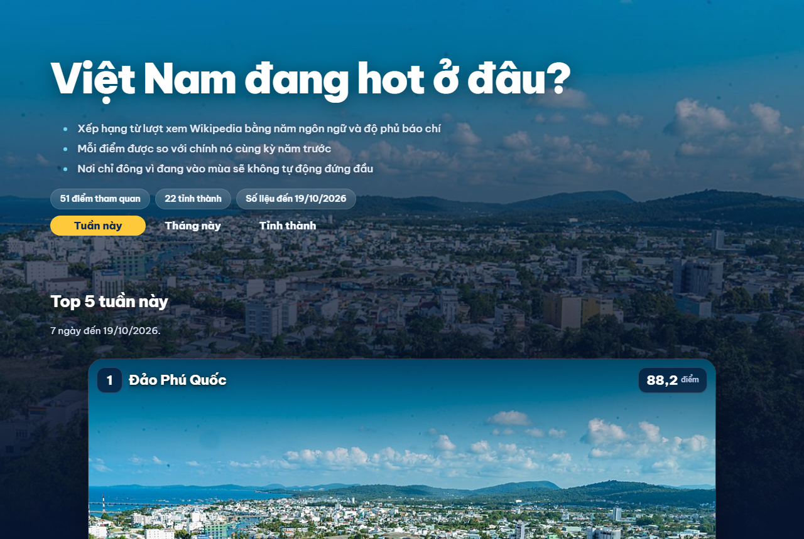
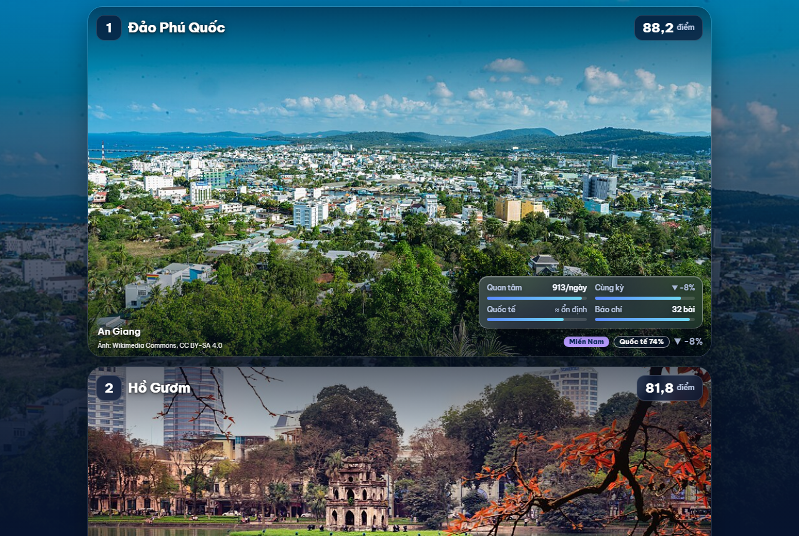
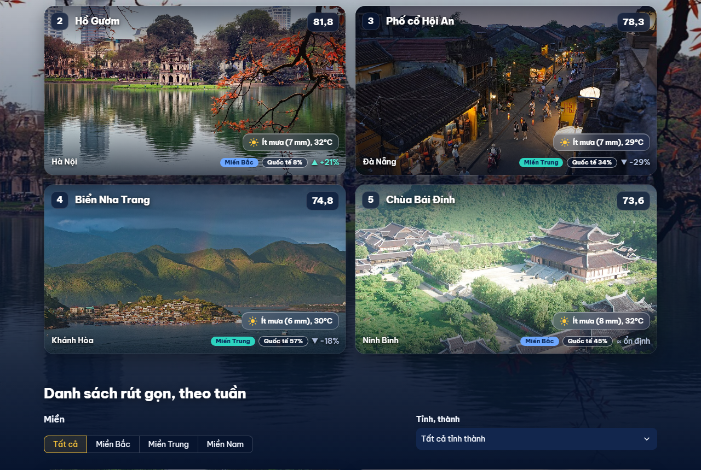
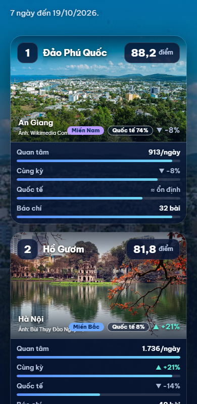

# VN Tourism Pipeline

**Xem dashboard trực tuyến: https://vn-hot-travel.streamlit.app/**

Pipeline dữ liệu near-real-time phát hiện **điểm du lịch đang được quan tâm nhiều ở Việt Nam**: thu thập từ nhiều nguồn độc lập, xử lý, mô hình hóa bằng dbt, điều phối bằng Airflow và hiển thị trên dashboard dạng áp phích có công tắc Tuần/Tháng.

```
Wikipedia Pageviews (vi, en, ko, zh, ja; 460 ngày) ─┐
Google News RSS (số bài theo tuần, 8 tuần) ─────────┤  Python ingest   ┌────────────┐   dbt    ┌──────────────┐
RSS báo (VnExpress, Tuổi Trẻ, Dân Trí, Thanh Niên) ─┼──(upsert)──────▶ │ Postgres   │ ───────▶ │ marts.*      │ ──▶ Streamlit
Open-Meteo (thời tiết) ─────────────────────────────┤                  │ raw.*      │          │ hot score    │
Google Trends (tùy chọn, thường bị chặn) ───────────┘                  └────────────┘          └──────────────┘
                              Airflow: chạy mỗi 3 giờ, ingest song song → trích địa danh → dbt run → dbt test
```

## Mô hình dữ liệu hai tầng

Xếp hạng ở mức **điểm tham quan cụ thể** (51 điểm như Hồ Gươm, Fansipan, Bà Nà Hills, Tràng An), mỗi điểm thuộc một **tỉnh/thành** (22 đơn vị, theo 34 đơn vị hành chính từ 7/2025) và một miền. Bảng tỉnh/thành là phép gộp bên trên, không phải đơn vị xếp hạng chính.

## Hot score

Điểm nóng (0 đến 100) là **trung bình cộng, trọng số bằng nhau**, của bốn thứ hạng phần trăm giữa các điểm trong cùng một ngày. Logic nằm ở macro `dbt/macros/hot_score.sql`, dùng chung cho xếp hạng **tuần** (7 ngày) và **tháng** (30 ngày). Không có trọng số nào để chỉnh tay cho ra thứ hạng "đẹp".

| Tín hiệu | Đo cái gì | Vì sao có mặt |
|---|---|---|
| Quan tâm | Lượt xem Wikipedia 5 ngôn ngữ, trung bình 7 hoặc 30 ngày | Quy mô: nơi ai cũng biết thì mới "hot" theo nghĩa nhiều người cân nhắc |
| Cùng kỳ | `ln((TB nay + K) / (TB cùng kỳ năm trước + K))`, lùi 364 ngày để trùng thứ trong tuần | Loại bỏ mùa vụ: chỉ phần tăng bất thường mới được tính |
| Quốc tế | Như trên, chỉ tính bài tiếng Anh, Hàn, Trung, Nhật | Người đọc các bản này chủ yếu sắp đi du lịch, không bị lịch học và làm việc ở Việt Nam chi phối |
| Báo chí | Số bài báo nhắc tên (Google News) giai đoạn gần nhất so với 4 tuần trước | Nguồn độc lập với Wikipedia, có lịch sử ngay từ lần chạy đầu |

Quy tắc đi kèm (cấu hình ở `dbt/dbt_project.yml`):

- Tín hiệu thiếu là NULL và bị loại khỏi trung bình, không bị tính thành 0.
- Điểm có lượng quan tâm thuộc 25% thấp nhất, hoặc có dưới 3 trong 4 tín hiệu, **không được xếp hạng** (hiện 38/51 điểm được xếp). Phần trăm tăng trên nền vài chục lượt xem chỉ là nhiễu: đảo Cô Tô (~16 lượt/ngày) từng vào top 10 chỉ vì thế.
- Mức tăng hoặc giảm quá 8 lần so với năm trước bị bỏ (`yoy_max_ratio`), vì thường do bài Wikipedia bị đổi tên hoặc tách trang.
- Điểm tỉnh/thành co về trung bình cả nước (shrinkage): `(tổng điểm + k × TB toàn quốc) / (số điểm + k)`.

**Vì sao thiết kế lại hai lần.** Bản đầu dùng z-score và Mũi Cà Mau đứng hạng 1 chỉ nhờ một ngày 72 lượt xem trên nền ~20. Bản thứ hai (55% lượt xem Wikipedia tiếng Việt, 30% xu hướng 4 tuần, 15% tin tức) vẫn cảm tính: gần như một nguồn duy nhất, và trọng số do người viết chọn. Khi đối chiếu số liệu thật, hai điều lộ ra (xem phần bài học bên dưới): lưu lượng theo lịch học, và bài bị đổi tên. Bản hiện tại bỏ xu hướng ngắn hạn, thêm cùng kỳ năm trước, tín hiệu quốc tế và báo chí, trọng số bằng nhau.

## Điểm thiết kế đáng chú ý

- **Idempotent:** mọi bước ghi bằng `INSERT ... ON CONFLICT DO UPDATE`, chạy lại hoặc backfill không tạo dữ liệu trùng.
- **Chịu lỗi từng nguồn:** một nguồn hoặc một bài lỗi không làm hỏng cả lô; Google Trends là tùy chọn và không chặn các bước sau.
- **Quan sát được:** `raw.ingest_runs` ghi mỗi lần chạy (số dòng, trạng thái, lỗi); dbt có source freshness và test (not_null, unique, relationships, grain, hồi quy cho điểm số).
- **Tên bài đa ngôn ngữ tự động:** bài en/ko/zh/ja lấy từ liên kết ngôn ngữ của bài tiếng Việt (`raw.place_wiki_titles`), không khai báo tay. Điểm có bài bị đổi tên khai báo thêm `extra_wiki_titles`, lượt xem được cộng theo ngày.
- **Xử lý tiếng Việt:** chuẩn hóa bỏ dấu (kể cả `đ`) và so khớp alias theo ranh giới từ.
- **dbt chạy trong venv riêng** trong image Airflow để tránh xung đột phiên bản thư viện.

## Dashboard

Một trang cuộn, nền là ảnh trình chiếu của các điểm đang đứng đầu, các khung thông số làm bằng hiệu ứng kính (glassmorphism), tôn trọng `prefers-reduced-motion`. Công tắc **Tuần này / Tháng này / Tỉnh thành** đổi toàn bộ trang; tag Tỉnh thành có xếp hạng tỉnh riêng theo tuần hoặc tháng. Top 5 xếp thành năm hàng tỉ lệ 16:9, ảnh tràn viền, khung kính nhỏ ở góc dưới bên phải chứa bốn chỉ số xếp 2x2, mỗi ô gồm nhãn, thanh cho biết điểm đó cao hơn bao nhiêu phần trăm số điểm còn lại, và giá trị thật (lượt xem mỗi ngày, tăng so với cùng kỳ, khách quốc tế, số bài báo). Màu theo miền dùng ba tông lạnh (xanh dương, xanh ngọc, tím), không dùng đỏ/vàng/xanh lá kiểu đèn giao thông. Ảnh lấy từ Wikimedia Commons, có ghi tác giả và giấy phép.










## Chạy cục bộ (không cần Docker)

Yêu cầu: Python 3.12+.

```bash
python -m venv .venv
.venv/Scripts/pip install -r requirements-dev.txt     # Windows; Linux/macOS: .venv/bin/pip
PYTHONPATH=src .venv/Scripts/python -m pytest -q
PYTHONPATH=src .venv/Scripts/python -m tourism.cli news --dry-run     # gọi nguồn thật, không ghi DB
PYTHONPATH=src .venv/Scripts/python -m tourism.cli wiki --dry-run --days 3
```

## Chạy toàn bộ stack (Docker)

```bash
docker compose up -d --build
docker compose exec airflow airflow dags trigger tourism_hot_places
```

- Airflow: http://localhost:8080 (mật khẩu admin do `airflow standalone` in ra trong log của container)
- Dashboard: http://localhost:8501
- Postgres: `localhost:5432`, user/password mặc định `tourism`/`tourism` (đổi bằng biến `POSTGRES_USER`, `POSTGRES_PASSWORD`)

Lần đầu cần backfill để có lịch sử cho so sánh cùng kỳ (Wikipedia 460 ngày, báo chí 8 tuần):

```bash
docker compose exec airflow python -c "from tourism.cli import main; main(['wiki', '--days', '460']); main(['gnews', '--days', '56'])"
```

DB đã có từ trước phải chạy migration `sql/migrations/002_multilang_views_and_news_volume.sql` (cột `lang`, bảng tên bài và số bài báo).

## Cấu trúc

```
config/      tỉnh/thành và điểm tham quan (places.yml), nguồn RSS (sources.yml), ảnh và giấy phép (place_images.json)
src/tourism/ ingest/ (news, wikipedia, news_volume, weather, trends, mentions), places.py, db.py, cli.py
scripts/     check_wiki_titles.py (kiểm tra tên bài), fetch_place_images.py (ảnh từ Commons)
sql/init/    schema raw, chạy khi Postgres khởi tạo lần đầu
sql/migrations/  chuyển DB đã có sang schema mới (001: hai tầng; 002: đa ngôn ngữ và số bài báo)
dbt/         staging → marts (fct_place_daily_signals, fct_hot_score, fct_hot_score_month, mart_hot_places_latest, mart_hot_provinces_latest)
dags/        DAG Airflow
app/         dashboard Streamlit (dashboard.py, style.css); .streamlit/ chứa theme
tests/       pytest
```

## Thêm hoặc đổi điểm tham quan

1. Sửa `config/places.yml` (alias tránh từ chung chung như "phố cổ"). Giá trị có dấu phẩy phải đặt trong nháy, nếu không YAML tách thành khóa lạ (có test bắt lỗi này).
2. Chạy `PYTHONPATH=src python scripts/check_wiki_titles.py`: báo tên bài không tồn tại, trang định hướng, trang chuyển hướng, lượt xem thấp.
3. Chạy `PYTHONPATH=src python scripts/fetch_place_images.py` để lấy ảnh (chỉ JPEG cảnh vật, loại bản đồ, logo, ảnh có người).
4. Nạp lại: `python -m tourism.cli load-places`, rồi `wiki --days 460`, `gnews --days 56`, `weather`, rồi `dbt build`.

Nếu thay đổi làm một điểm biến mất khỏi danh sách, xóa dữ liệu phụ thuộc của nó trước (xem `sql/migrations/001_place_hierarchy.sql`).

## Chạy dbt khi mạng chậm (Windows)

`dbt-postgres` 1.9 chưa chắc chạy ổn trên Python 3.13+. Nếu build image dbt quá chậm, cài trực tiếp bằng [uv](https://docs.astral.sh/uv/) và để dbt nối vào Postgres qua `localhost`:

```bash
uv venv .venv-dbt --python 3.12
uv pip install --python .venv-dbt/Scripts/python.exe dbt-postgres==1.9.0
cd dbt && ../.venv-dbt/Scripts/dbt build --profiles-dir .
```

Giữ chú thích trong `dbt_project.yml` bằng ASCII: dbt đọc file này theo bảng mã mặc định của Windows.

## Bài học về chất lượng dữ liệu (đã gặp khi chạy thật)

- **Lưu lượng Wikipedia mang nhịp học tập, không chỉ du lịch.** Hồ Gươm có 700 đến 4.400 lượt xem vào ngày thường nhưng chỉ ~200 vào cuối tuần, và tăng vọt vào tháng 10 (bài "Sự tích Hồ Gươm" trong chương trình học). Chỉ số "xu hướng so với 4 tuần trước" vì thế đẩy Hồ Gươm lên hạng 1. Cách xử lý: bỏ xu hướng ngắn hạn, so với cùng kỳ năm trước (mùa vụ lặp lại nên bị triệt tiêu) và thêm tín hiệu chỉ từ bài ngoại ngữ.
- **Bài Wikipedia bị đổi tên hoặc tách trang làm hỏng so sánh cùng kỳ.** "Sa Pa" bị tách thành "Sa Pa" và "Sa Pa (thị xã)" rồi đổi chỗ nhiều lần: tăng giả +1.506% so với năm trước và không có bản ngoại ngữ. Cộng lượt xem hai bài (`extra_wiki_titles`) cho ra +49%, hợp lý với mùa lúa chín. Mức thay đổi quá 8 lần giờ tự bị bỏ.
- **Phần trăm tăng trên nền nhỏ là nhiễu.** Xếp hạng phần trăm khuếch đại chênh lệch rất nhỏ giữa các điểm ít người xem, nên điểm dưới 25% quy mô không được xếp hạng. Test `hot_score_single_day_spike_cannot_win` giữ quy tắc này (từng là lỗi Mũi Cà Mau).
- **Tên bài Wikipedia có thể là trang chuyển hướng hoặc trang định hướng.** Lần đầu 10/29 địa điểm có lượt xem thấp giả tạo; khi chuyển sang điểm tham quan, 21/54 mục cần xử lý. Từ đó có `scripts/check_wiki_titles.py`.
- **Một nguồn duy nhất thì mọi thiên lệch của nó thành kết quả.** Google Trends bị chặn (429) và GDELT cũng giới hạn tần suất, nên nguồn thứ hai là Google News RSS tìm theo khoảng ngày (lọc 7 ngày vẫn dưới mức giới hạn ~100 bài), có lịch sử ngay mà không phải chờ tích lũy.
- **Thiếu dữ liệu không phải là 0 hay điểm phạt.** `greatest(NULL, -3)` trong Postgres trả về -3 nên ngày mới nhất từng bị trừ oan. Tín hiệu thiếu giờ là NULL (có test hồi quy).
- **Ảnh minh họa cần lọc.** Lần đầu có bản đồ cho Hồ Ba Bể, ảnh trẻ em cho Mộc Châu, cờ và SVG. Giờ chỉ nhận JPEG, loại từ khóa bản đồ/logo/cờ và ảnh có người, luôn lưu tác giả và giấy phép (có test).
- **Test pass không có nghĩa là kết quả đúng.** Các lỗi lớn nhất đều qua mọi test cho tới khi đọc kết quả thật và hỏi "có hợp lý không". Quy trình: sau mỗi lần đổi cách chấm điểm, đọc top 10 trước khi tin test.

## Hạn chế đã biết

- **Đo quan tâm, không đo số người đến.** Số khách thật theo địa điểm không được công bố theo ngày. Lượt xem Wikipedia vẫn có thể lẫn lưu lượng tự động; bài báo có thể nhắc một nơi vì lý do ngoài du lịch. Nên xem bảng là gợi ý để tìm hiểu thêm.
- **Wikipedia giảm lượt xem nói chung** (hầu hết điểm âm so với năm trước), nên cùng kỳ là thước đo tương đối giữa các điểm, không phải mức tăng tuyệt đối.
- **13/51 điểm chưa được xếp hạng** vì quy mô quá nhỏ; dashboard liệt kê tên các điểm này.
- **Google Trends** dùng `pytrends` (không chính thức), thường bị chặn 429, nên không nằm trong điểm.
- **Nhận diện địa danh bằng từ điển alias**, chưa dùng NER; tên mơ hồ có thể khớp nhầm.
- **Tên tỉnh/thành theo 34 đơn vị hành chính từ 7/2025** do người viết tự tổng hợp, chưa đối chiếu nguồn chính thức.
- **Đã kiểm chứng:** pytest (15 test), ruff, ingest dữ liệu thật vào Postgres (Docker), `dbt build` (30 mục pass), dashboard trên trình duyệt (khổ rộng, cả hai chế độ tuần và tháng, và khổ điện thoại 375 px không tràn ngang ở lần kiểm tra trước khi đổi sang thẻ ảnh tràn viền).
- **Đã kiểm chứng:** DAG `tourism_hot_places` chạy end-to-end trong Airflow (10/10 task thành công, kể cả `ingest_news_volume` và `dbt_test`). Lần chạy đầu lộ ra ba lỗi mà test cục bộ không thấy: hàm ingest nhận cả ngữ cảnh Airflow, thư mục dbt gắn từ máy chủ không ghi được log, và ngày mới nhất của Wikipedia mới có số liệu cho vài điểm nên làm mốc xếp hạng bị lệch (nay chỉ lấy ngày đã phủ từ 90% số điểm).
- **Chưa kiểm chứng:** image dashboard chưa build.

## Đưa dashboard lên web

Dashboard đọc Postgres khi chạy cục bộ. Bản đưa lên web không có CSDL nên đọc ảnh chụp dữ liệu trong `app/snapshot/`
(tự dùng khi không kết nối được Postgres, hoặc đặt `DASHBOARD_SNAPSHOT=1`).

1. Cập nhật dữ liệu: chạy pipeline và dbt, rồi `python scripts/export_snapshot.py`, commit thư mục `app/snapshot/` và push.
2. Vào https://share.streamlit.io, đăng nhập bằng GitHub, chọn **Create app**: repository `dtkhang05/vn-tourism-pipeline`,
   branch `main`, file chính `app/dashboard.py`. Mỗi lần push, Streamlit Cloud tự nạp lại trang.
3. Dependencies lấy từ `app/requirements.txt`.

Workflow `refresh-data` chạy mỗi ngày: thu thập, dbt, xuất snapshot và commit. Lịch sử xếp hạng từng ngày được cộng dồn trong
`app/snapshot/history.parquet` (mỗi ngày số liệu một lượt, chạy lại không nhân đôi), dashboard dùng nó để vẽ biểu đồ xu hướng
khi có từ hai ngày trở lên. Nếu workflow lỗi, nó tự mở một issue trên GitHub, và dashboard hiện cảnh báo khi số liệu cũ hơn 3 ngày.
